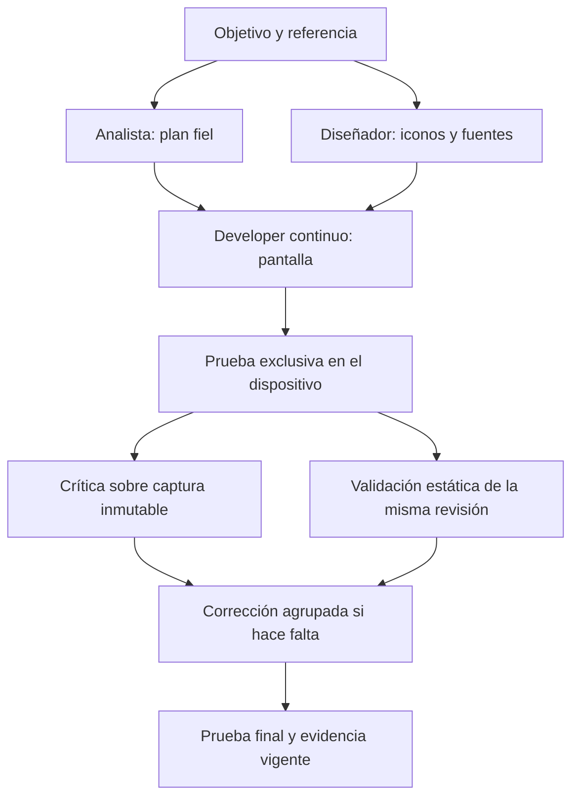

# Paralelismo de xonecode con TrueForge Core

Fecha: 4 de noviembre de 2026. Escrito sobre el commit `ec5082ee` (worktree `developer-continuo`); revisado e implementado en parte en la rama `paralelismo`, desde `main` en `ea2ed8f2`, con `@truefoundry/trueforge-core` **0.181.0** instalado.

**Estado** (rama `paralelismo`):

| Entrega | Estado |
|---|---|
| A. Contrato | **Hecha.** Los cinco tests de contrato de §4, con barreras: 1 (lote de tools concurrente, `modeloLangchain.test.ts`), 2–3 (hermanos a la vez y padre sin llamar a su modelo con hijos vivos) y 5 (cancelar aborta la llamada de todos los hijos) en verde en `sesionTrueforge.test.ts`; **el 4 destapa un hueco** (ver «Hallazgo», abajo): arreglado en autónomo (4b), pendiente en supervisado (`it.fails`). La telemetría temporal no se añadió: el lote ya se deduce de la traza (`llamadasModelo` por origen y `at` de cada evento). |
| B. Recursos compartidos | **Dispositivo: hecho** (§5.2, `colaDelAparato.ts`). **Escrituras: ya existía** dentro de una sesión (ver §2); entre sesiones o procesos, pendiente. |
| C, D, E | Sin empezar. |

**Hallazgo del contrato 4 — una aprobación espera a que acaben los hermanos.** Con dos hijos trabajando, la escritura
de uno que pasa por la aprobación de la librería **no se resuelve hasta que el otro termina**: el motor sigue ejecutando
a los hermanos vivos hasta que ninguno puede avanzar, y `paso()` (`sesionTrueforge.ts`) junta las aprobaciones y solo las
decide cuando acaba `orquestador.execute`.

- **Autónomo: ARREGLADO** (contrato 4b, `sesionTrueforge.test.ts`). Era el caso caro: la escritura esperaba aunque se
  fuera a aplicar sola. Ahora un hijo que nace en autónomo escribe sin la interrupción de aprobación
  (`escribeSinPreguntar`, la misma pieza que ya usaban las tareas de fondo) y lo escrito sigue saliendo en «aplicadas
  SIN aprobación». El modo se lee en CADA escritura (`modoVigenteAlEscribir.ts`, recomendación §3 de
  `REVISION-PARALELISMO-UN-DISPOSITIVO.md`): si la persona pasa a supervisado a mitad de un encargo, lo que pediría
  aprobación se rechaza con su motivo y el hijo lo dice al devolver; también `incorporar_adjunto` y `traer_fuente`,
  que escriben al disco sin pasar por el backend (`conModoVigenteEnPropias`). Las escrituras de un CONECTOR y las del aparato siguen parando.
- **Supervisado: PENDIENTE** (contrato 4, `it.fails`). Sin tocar la librería solo se puede adelantar la TARJETA (pedir la
  decisión al llegar el evento y entregarla al acabar la ejecución): el que escribe seguiría esperando a sus hermanos,
  porque el motor solo replanifica hilos entre lotes. Y con la pregunta abierta mientras el hermano sigue pintando
  líneas, las pieles de terminal (stdio, TUI) mezclarían su salida con la pregunta. Lo completo —que el que escribe siga
  sin esperar— es replanificar dentro de la librería: entrega E.

Los nombres de módulos, herramientas y banderas que se proponen para las fases C–E no son APIs existentes. El análisis se basa en el código local instalado; no presupone capacidades de versiones posteriores de TrueForge.

## 1. Decisión recomendada

Mantener TrueForge Core. Aprovechar primero su paralelismo de herramientas y subagentes hermanos, añadiendo coordinación por recursos y medición. Evaluar después un coordinador que permita al padre continuar mientras trabajan sus hijos.

No hace falta reemplazar el harness para ejecutar lecturas independientes o lanzar analista y diseñador a la vez. Sí hace falta cambiar la coordinación para reproducir un flujo de lanzamiento no bloqueante, consulta de estado y continuación del mismo agente.

Objetivos separados:

- **Menor tiempo:** solapar trabajos independientes.
- **Menos llamadas al modelo:** agrupar herramientas en una respuesta y reducir las delegaciones rechazadas/repetidas.
- **Menos coste:** evitar exploración duplicada y mantener prefijos estables. Más agentes pueden aumentar el consumo aunque terminen antes.
- **Misma calidad:** conservar fidelidad, pruebas funcionales y evidencia vigente.

## 2. Qué hace hoy realmente

| Nivel | Comportamiento comprobado | Consecuencia |
|---|---|---|
| Herramientas de una respuesta | `executeToolCalls` construye las promesas con `map` y espera `Promise.all` | Las llamadas ya pueden ejecutarse concurrentemente; el siguiente paso del modelo espera al lote |
| Subagentes hermanos | El orquestador procesa lotes de hasta cinco hilos activos | Analista y diseñador pueden trabajar a la vez |
| Padre e hijos | `getActiveAgentThreads` selecciona las hojas del árbol | Un padre con hijos activos no vuelve a ejecutar su propio modelo |
| Escrituras | `escriturasEnSerie` crea una cola por ruta dentro de cada envoltorio, y **todos los especialistas de una sesión comparten el MISMO backend** (`montarBackend()` una vez en `sesionTrueforge.ts`) | Ya hay exclusión entre agentes de una sesión; no entre sesiones ni procesos sobre el mismo proyecto. `proyectoSinShell` anota esas escrituras (`conEscriturasAnotadas`) para no deshacerlas |
| Aparato | **Antes no había cola**: dos scripts de una respuesta corrían con `Promise.all` y el hotswap cierra la conexión anterior | Hecho: `colaDelAparato.ts`, una cola por aparato para toda la sesión (test de integración en `sesionTrueforge.test.ts`) |
| Dependencias de agentes | `esperas.ts` rechaza el arranque si está vivo o anunciado un agente requerido | Evita el bloqueo, pero obliga a una nueva delegación |
| Continuidad | Se crea otro `AgentThread` y se hereda su conversación | Hay continuidad de contexto dentro de la sesión, no una API nativa de reanudación equivalente a `send_input` |

Fuentes locales verificadas:

- `node_modules/@truefoundry/trueforge-core/dist/core/mcp/executeToolCalls.mjs`: ejecución concurrente y reunión del lote.
- `node_modules/@truefoundry/trueforge-core/dist/core/runtime/AgentThreadOrchestrator.mjs`: `MAX_PARALLEL_SUB_AGENTS = 5`, selección de hojas y mezcla de generadores.
- [sesionTrueforge.ts](../src/agent/motores/trueforge/sesionTrueforge.ts): `crearHijo`, `nuevoOrquestador` y montaje de `dynamicSubAgents`.
- [esperas.ts](../src/agent/motores/trueforge/esperas.ts): dependencia entre especialistas y rechazo inmediato.
- [escriturasEnSerie.ts](../src/agent/grafo/escriturasEnSerie.ts) y [serieDeEscrituras.ts](../src/core/serieDeEscrituras.ts): alcance de las colas y regla comunicada al modelo.

La última traza revisada también muestra delegaciones a analista y diseñador en el mismo instante. El paralelismo entre hermanos ya se utiliza; el objetivo es aprovecharlo mejor, no simplemente activarlo.

## 3. Qué paralelizar y qué conservar en serie

| Trabajo | Propuesta | Condición |
|---|---|---|
| Lecturas de varios ficheros | Paralelo en una respuesta | Ninguna lectura depende del resultado de otra |
| Búsquedas independientes | Paralelo | Consultas acotadas; evitar repetir la misma exploración con varios agentes |
| Plan y recursos visuales | Analista + diseñador hermanos | Referencia común y alcance de recursos definido; el plan integra el manifiesto final |
| Escrituras de ficheros independientes | Paralelo | Propiedad de rutas y coordinación compartida; comprobar también dependencias semánticas |
| Cambios al mismo fichero | Una edición múltiple o serie | Validación y escritura bajo la misma exclusión |
| Pruebas en un único emulador | Serie por dispositivo | Recarga, apertura, interacción, log y captura forman una operación coherente |
| Crítica de captura y análisis estático | Paralelo sobre una revisión fija | La crítica lee un artefacto inmutable y la revisión identifica huellas de ficheros |
| Developer construyendo mientras otro agente modifica sus recursos | Esperar el recurso o separar fases | No asumir que trabajar en carpetas distintas elimina la dependencia |
| Padre trabajando mientras su hijo sigue | Fase posterior | Requiere coordinación distinta a la selección actual de hojas |

No convertir `xone-probar` en varias acciones concurrentes: su orden es parte de la validez de la prueba. Tampoco usar `;` o `&&` como si fueran paralelismo: encadenan acciones.

## 4. Fase 0: medir y fijar el contrato actual

Antes de cambiar ejecución, añadir pruebas con herramientas falsas controladas mediante promesas:

1. Dos lecturas independientes entran ambas antes de liberar cualquiera.
2. Dos hijos hermanos arrancan antes de terminar el primero.
3. El padre no vuelve a llamar al modelo mientras conserva un hijo activo.
4. Una aprobación de un hijo llega al consumidor aunque otro hijo siga trabajando.
5. Cancelar un turno alcanza a todos los trabajos que haya iniciado.

No usar duraciones arbitrarias como prueba de concurrencia: registrar entrada/salida y usar barreras explícitas. Todo debe funcionar sin clave, red ni emulador.

Añadir telemetría interna con: identificador de operación y lote, hilo, clase de operación, inicio, fin, tiempo en cola y motivo de espera. Conservar el filtro de privacidad de eventos de dominio: no transportar argumentos, contenido ni credenciales al transcript. Las rutas que se publiquen deben pasar por la política existente.

Medir por separado tiempo de modelo, herramientas, espera por recursos, aprobaciones, delegaciones rechazadas y compactaciones. Sin estos datos no sabremos si paralelizar reduce el camino que determina la duración total.

## 5. Fase 1: coordinación compartida de recursos

### 5.1 Escrituras

Crear un coordinador por proyecto y compartirlo entre los backends que operan sobre él. No basta con añadir otra cola local a cada especialista.

Pasos:

1. Resolver la identidad del proyecto y la ruta canónica del recurso después de aplicar las guardas de permisos.
2. Inyectar el mismo coordinador en `backendDeAgente`/`escriturasEnSerie` para todos los especialistas del proyecto.
3. Mantener dentro del tramo protegido la lectura, resolución del cambio, validación y escritura.
4. Revalidar al ejecutar una escritura aprobada si el fichero cambió mientras se esperaba la decisión humana.
5. Incluir recursos compartidos adicionales: planes, manifiestos y evidencia, cuando sus actualizaciones sean leer-modificar-escribir.

En un servidor con varias sesiones abiertas sobre el mismo proyecto, el coordinador debe compartirse entre sesiones. Si hay varios procesos independientes escribiendo, la cola en memoria no basta: se necesita exclusión entre procesos o aislamiento de checkouts. Declarar ese alcance antes de habilitar la función.

Conservar los permisos por perfil y las rutas virtuales. Una propiedad de fichero coordina trabajo; no concede permisos nuevos.

### 5.2 Dispositivo

Crear una cola por dispositivo resuelto, no por nombre de agente. Dos puertos pueden representar el mismo dispositivo; usar su identidad efectiva.

- Una ejecución de `xone-probar` conserva el turno durante todo el ciclo.
- Recargas, navegación, clics y captura coordinada usan la misma cola.
- Un análisis de una captura ya guardada no ocupa el dispositivo.
- La espera se puede cancelar; no deja operaciones huérfanas en la cola.
- No mantener el dispositivo reservado mientras se espera una aprobación humana o una llamada larga al modelo.

Revisar además [proyectoSinShell.ts](../src/agent/motores/trueforge/proyectoSinShell.ts): su comparación y restauración del proyecto debe ser compatible con escrituras legítimas concurrentes. Un segundo proceso de shell no puede deshacer cambios válidos del primero o de otro agente.

### 5.3 Pruebas de aceptación

- Dos backends distintos que editan la misma ruta no pierden cambios silenciosamente.
- Dos ficheros independientes sí progresan en paralelo.
- Dos pruebas sobre el mismo dispositivo nunca intercalan recarga y captura.
- Dos dispositivos distintos pueden avanzar simultáneamente.
- Error, cancelación y rechazo liberan recursos y no bloquean el siguiente trabajo.
- No se mantiene un bloqueo esperando una decisión que necesita que el mismo ejecutor devuelva el control.

## 6. Fase 2: aprovechar el planificador actual

Mantener `AgentThreadOrchestrator` y `dynamicSubAgents` en esta fase.

### 6.1 Agrupación de herramientas

Actualizar las instrucciones de trabajo para pedir juntas las lecturas/búsquedas independientes. Ya existe `REGLA_DE_ESCRITURAS_EN_PARALELO`; extender su uso con ejemplos breves, sin duplicar instrucciones por todo el sistema.

Ejemplo: leer `Menu.xne`, la referencia CSS y el diseño en una respuesta; después decidir la edición. No agrupar una lectura con una edición que necesita conocer su resultado.

Registrar número de llamadas al modelo y tamaño del lote. Diez herramientas dentro de una respuesta siguen siendo diez ejecuciones, pero evitan nueve rondas de modelo respecto a solicitarlas individualmente.

### 6.2 Reparto entre especialistas

El orquestador puede lanzar en el mismo mensaje:

- Analista: plan, criterios y estructura de la pantalla.
- Diseñador: recursos concretos de la referencia, dentro de sus rutas permitidas.

Ambos reciben el objetivo original y la referencia. El diseñador entrega un manifiesto de recursos; el developer recibe plan y manifiesto antes de consumirlos. Mantener un único developer para la implementación principal y su conversación continua.

No convertir todo en subagentes: una lectura breve suele ser más barata dentro de un lote del developer que abrir otro contexto.

### 6.3 Dependencias

Mantener inicialmente la protección de `esperas.ts`. Evitar lanzamientos incompatibles mediante el plan y los mensajes de resultado.

Para eliminar el coste de rechazo y redelegación, una fase posterior puede representar el encargo como `pendiente-de-dependencia` y activarlo desde el coordinador cuando se satisfaga. **No implementar esto como una promesa bloqueada dentro de un paso del agente.** El código documenta un bloqueo previo entre espera y aprobación que debe seguir cubierto por pruebas.

No retirar globalmente `developer espera designer`. Si se permite al developer adelantar lógica independiente, el encargo debe delimitar qué puede construir y qué no puede integrar todavía.

## 7. Fase 3: padre e hijos concurrentes

Esta fase es un cambio de arquitectura; no se consigue elevando el límite de cinco ni añadiendo una frase al prompt.

Dos alternativas a evaluar:

1. Extender el planificador de TrueForge mediante un cambio revisable, idealmente contribuido al proyecto upstream.
2. Mantener `AgentThread` como ejecutor y desarrollar en xonecode un coordinador de trabajos que gestione la ejecución independiente.

No editar `node_modules` como solución permanente. No afirmar que existe una API pública para este modo sin comprobarla.

### Contrato propuesto

Herramientas conceptuales: `lanzar_agente`, `estado_agente`, `enviar_a_agente` y `esperar_agentes`.

- Lanzar devuelve un identificador inmediatamente; el resultado final se entrega como evento posterior, no como una segunda respuesta a la misma llamada de herramienta.
- Enviar añade un encargo al mismo identificador lógico de especialista. Si está ocupado, se encola o se rechaza explícitamente; nunca abre dos conversaciones activas del mismo developer por accidente.
- Consultar devuelve un estado pequeño y un cursor, sin copiar todo el historial.
- Esperar registra una suspensión del padre que no bloquea a los hijos ni la entrega de aprobaciones.
- Los resultados se incorporan una vez, en un punto definido del historial; no se reescribe el prefijo ya enviado.

Estados mínimos: pendiente, ejecutando, esperando dependencia, esperando aprobación, terminado, fallido y cancelado. Cada transición debe tener dueño y ser idempotente.

Integrar desde el principio:

- Cancelación del padre y política explícita para todos sus descendientes.
- Aprobaciones dirigidas al hilo correcto, sin aprobar implícitamente por estar en segundo plano.
- Presupuesto global y por agente; concurrencia limitada.
- Guardado de trabajos pendientes y reconciliación tras reinicio: reanudar donde sea seguro o declarar interrupción, nunca repetir escrituras a ciegas.
- Notas del usuario enrutadas al dueño del trabajo.
- Memoria e imágenes necesarias para continuar; la persistencia actual de la sesión no garantiza recuperar toda la memoria de especialistas.
- Finalización del turno solo cuando se han resuelto o cancelado sus trabajos pendientes.

Primera prueba de este modo: hijo de solo lectura mientras el padre hace otra lectura. Después probar aprobación, cancelación y recuperación. Habilitar escritores únicamente cuando esos casos estén cubiertos.

## 8. Secuencia propuesta para la calculadora

La crítica y la validación pueden solaparse porque examinan una revisión fija. Si el developer cambia esa revisión antes del cierre, sus resultados no justifican marcar criterios sobre la nueva versión. Conservar las huellas de la ficha de trabajo.

## 9. Cómo demostrar que mejora

Comparar baseline y variante con el mismo modelo, proveedor/API, esfuerzo, proyecto inicial, maqueta, skills y alcance. Registrar versiones y flags. Los ficheros de recursos preexistentes también forman parte del baseline.

Ejecutar al menos dos repeticiones por variante para detectar variación; ampliar si los resultados se solapan. Declarar el estado inicial de caché y alternar el orden de ejecución cuando sea posible.

| Dimensión | Métrica |
|---|---|
| Tiempo | Hasta plan terminado, pantalla validada y tarea completa |
| Trabajo | Llamadas al modelo, herramientas, relecturas y delegaciones rechazadas |
| Coste | Entrada fresca, entrada en caché, salida y precio real del proveedor cuando esté disponible |
| Concurrencia | Tiempo solapado y tiempo esperando recursos/dependencias |
| Contexto | Compactaciones, tamaño antes/después y reuso del historial |
| Calidad | Mismos casos funcionales, piezas visuales presentes y discrepancias pendientes |
| Corrección | Conflictos, escrituras perdidas, capturas de pantalla equivocada y evidencia caducada |

No presentar `frescos + 0,1 × caché + salida` como coste facturado: es una ponderación experimental. Tampoco comparar una pantalla inspirada en la maqueta con otra que exige fidelidad completa.

Criterio de promoción: menor tiempo o coste con calidad equivalente, sin regresiones de permisos, cancelación o integridad. Un ahorro de tiempo con subida de coste se presenta como intercambio, no como mejora universal.

## 10. Entregas y orden de implementación

| Entrega | Cambios principales | Condición para avanzar |
|---|---|---|
| A. Contrato y medición | Tests del comportamiento actual y trazas temporales | Se distingue ejecución de espera |
| B. Recursos compartidos | Coordinación de escrituras y dispositivo | Pruebas entre backends/sesiones y cancelación en verde |
| C. Paralelismo existente | Agrupación de tools y encargos independientes | Calculadora comparable, sin duplicación de exploración |
| D. Dependencias diferidas | Encargos pendientes sin redelegación del modelo | Sin bloqueo ante aprobaciones |
| E. Padre no bloqueante | Prototipo aislado del coordinador | Recuperación, cancelación y resultados idempotentes |

Mantener las piezas puras en `src/core/`, sin imports del motor. Los adaptadores y el ciclo de vida van en `src/agent/motores/trueforge/`; conservar `trueforge.ts` como frontera de imports de la librería.

Usar flags independientes, propuestos, para las fases experimentales. Apagarlos debe restaurar la ejecución anterior sin invalidar sesiones guardadas. Si cambia el formato persistido, añadir migración o rechazo explícito compatible con la política actual.

No sustituir la evidencia de pruebas por instrucciones del prompt. No empezar por más developers ni por elevar concurrencia: empezar por coordinar recursos, agrupar trabajo y medir el camino que determina la duración.
